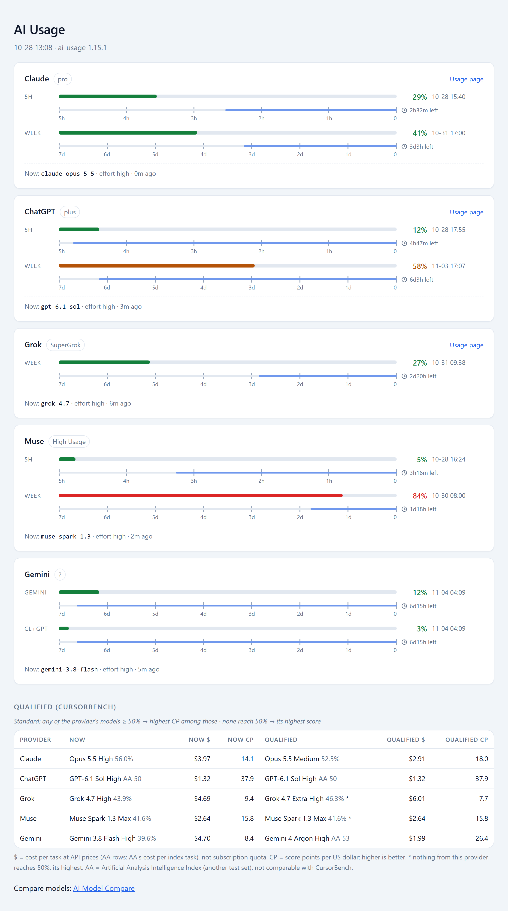
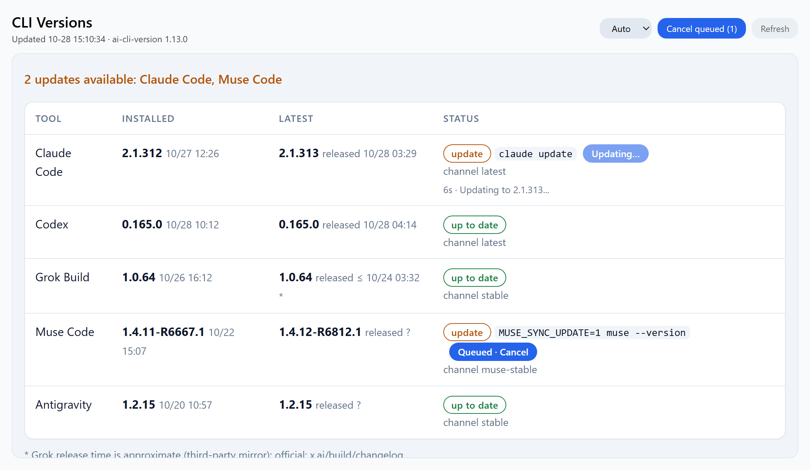
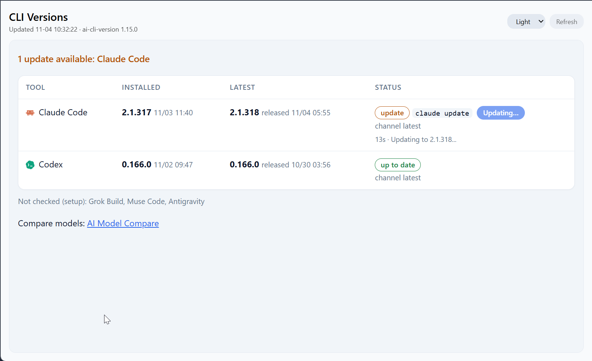

# Jeinn Agent Skills

> 中文版。英文版 [README.md](README.md) 為準，本檔為對照翻譯，兩邊同步更新。

給 Claude Code、Codex CLI、Grok Build，以及任何讀 `SKILL.md` 慣例的 agent 使用的
skills。各 skill 支援的 host 與先決條件不同。

```bash
npx skills add Jeinn-co/agent-skills -g --skill '*' -a codex claude-code antigravity-cli -y
```

[在 skills.sh 上瀏覽](https://skills.sh/jeinn-co/agent-skills) · English: [README.md](README.md)

> 安裝前請先讀該 skill 自己的 README —— 裡面列出你機器上需要先有什麼。

## Skills

| Skill | 做什麼 | 說明文件 |
|---|---|---|
| [`ai-usage`](skills/ai-usage/) | 一份報表看完 Claude、ChatGPT、Grok、Muse、Gemini（Antigravity CLI）五邊訂閱還剩多少 —— 用掉幾 %、各視窗何時重置、還有多少加購額度，以及每個 CLI 目前的 model 與 effort、以及那個 model 在 CursorBench 的分數、成本與 CP。`setup` 可挑要報告哪些 provider。三個 skill 每次呼叫都會自動安裝自己的新版，再繼續原本工作。 | [English](skills/ai-usage/README.md) · [中文](skills/ai-usage/README.zh-TW.md) |
| [`ai-cli-version`](skills/ai-cli-version/) | 你的 Claude Code、Codex、Grok Build、Muse Code、Antigravity（Gemini）CLI 是不是最新版 —— 目前版本和安裝時間、最新版本和發佈時間。有更新時，可選 `y` 全部更新或 `Esc` 跳過；`setup` 可挑要檢查哪些 CLI。目前已在 Windows 與 macOS 測試，Linux 尚未測試。 | [English](skills/ai-cli-version/README.md) · [中文](skills/ai-cli-version/README.zh-TW.md) |
| [`s-agent`](skills/s-agent/) | 對齊 `/uu` 角色分層，同步 Codex／Claude Code／Antigravity（Gemini）的獨立 `reviewer`／`security` 設定；日常開發與 UI 留主線配 Skills，跨專案或純問答的外部 AI CLI 自動切到 `/tmp` 乾淨執行以免載入重專案前綴。 | [English](skills/s-agent/README.md) · [中文](skills/s-agent/README.zh-TW.md) |

`/ai-usage` —— 在瀏覽器打開的 HTML 報表（示範資料）。會開在本機頁面上，有 Refresh 按鈕和
Auto / Light / Dark 切換：



`/ai-cli-version`，五個 CLI 都檢查過（示範資料），畫面是本機頁面。有 CLI 過期時（如圖），可以在
頁面上按該列的 **Update**（或 **Update all**），也可以在對話框回答 `y` / `Esc`：



實際執行，按下 Claude Code 那列的 **Update** 後正在更新：



## 安裝

用 `npx` 安裝需要 Node.js 與 npm。安裝前先確認：

```bash
node --version
npx --version
```

目前的 `skills` CLI 宣告需要 Node.js 22.20 以上。如果環境沒有這個版本，請改用下方的
手動複製方式；skill 執行時本身不需要 Node.js。

```bash
npx skills add Jeinn-co/agent-skills -g --skill '*' -a codex claude-code antigravity-cli -y
```

這會把三個公開 skill 安裝給 Codex、Claude Code 與 Antigravity CLI。
只保留你使用的 agent。兩個報表 skill 另支援 `grok`；S-Agent 支援上面列出的三個工具。
只裝單一 skill 時，把 `--skill '*'` 換成名稱；不加 `-g` 則安裝到目前專案。

安裝器將實體檔案放在 `~/.agents/skills/`，再接到所選工具的入口。
Codex 直接讀取共用目錄；Claude Code 使用 `~/.claude/skills/`，
Antigravity 使用 `~/.gemini/config/skills/`。保留預設共用／symlink 模式；
無法建立連結時可用 `--copy`，每份副本都包含執行與更新所需的內容。
不需要連到發布者的開發 repo。

沒有 Node/npm 時，可將完整的 `skills/<名稱>/` 複製到工具的技能目錄。
腳本、assets、locales、data、references 都要保留，只複製 `SKILL.md` 不夠。
使用 `/ai-usage`、`/ai-cli-version`、`/s-agent`；Codex 使用對應的 `$ai-usage`、
`$ai-cli-version`、`$s-agent`。`uu`、`check-uu` 等個人別名不是安裝先決條件。

換到新機器後，使用該機器的 Python、已安裝工具與已登入帳號。
報表會將缺少的 provider 標示為不可用；S-Agent 會讀取選定的 Notion 設定，
確認模型支援後建立缺少的角色檔，不需要複製發布者的憑證、角色檔或本機設定。
若安裝後沒有出現 skill，請開新對話或重新啟動工具。

## 更新

每次呼叫會自動檢查並安裝新版 skill，再繼續原本工作。手動複製的副本也適用，
不需要 Node/npm 或安裝紀錄。Skill 目錄外的使用者設定保留；失敗時保留或還原舊版，
開發用 checkout 不會被覆寫。

透過安裝器管理的副本，也可明確執行：

```bash
npx skills update ai-usage -g -y          # global 安裝
npx skills update ai-cli-version -g -y    # global 安裝
npx skills update ai-usage -p -y          # project 安裝（ai-cli-version 同理）
```

透過安裝器更新後請開新對話或重新啟動 agent，讓它重新載入 skill。手動複製的副本
則使用相同的呼叫時自動更新流程。

## 測試

使用 Python 3.11+（S-Agent sync 的需求），在 repository 根目錄執行回歸測試：

```bash
python3.11 -m unittest discover -v -s tests
```

## 慣例

- **英文為準。** 文件旁邊的 `.zh-TW.md` 是鏡像；一邊改動，另一邊在同一個 commit 裡跟著改。
- **預設英文輸出。** 腳本輸出的資料與狀態訊息使用英文。Agent 可依 host 提供的電腦偏好語言，
  或使用者明確指定的語言翻譯報表；沒有這些資訊時用英文，不從先前對話猜語言。
- **說明跟著 skill 走。** 使用者裝完之後會需要的內容，一律放在 `skills/<name>/` 裡面，
  不放在這裡。這一頁只是索引。
- **每個 skill 只有一個版本來源。** 升版只改 `SKILL.md` 的 `metadata.version`；
  CLI 輸出、報表標頭與更新檢查都讀這個值。這個值只供辨識：`npx skills` 會用來源與
  內容 hash 追蹤它安裝的 skill；手動複製的版本則沒有更新紀錄。
- **共用資源只有一個來源。** 修改 `shared/` 後執行
  `python3.11 scripts/sync_shared.py`，把分發到各 skill 的檔案一起提交。
  各 skill 仍可獨立安裝；翻譯與模型資料的位置見[資源分工](shared/README.md)。

## 授權

MIT
