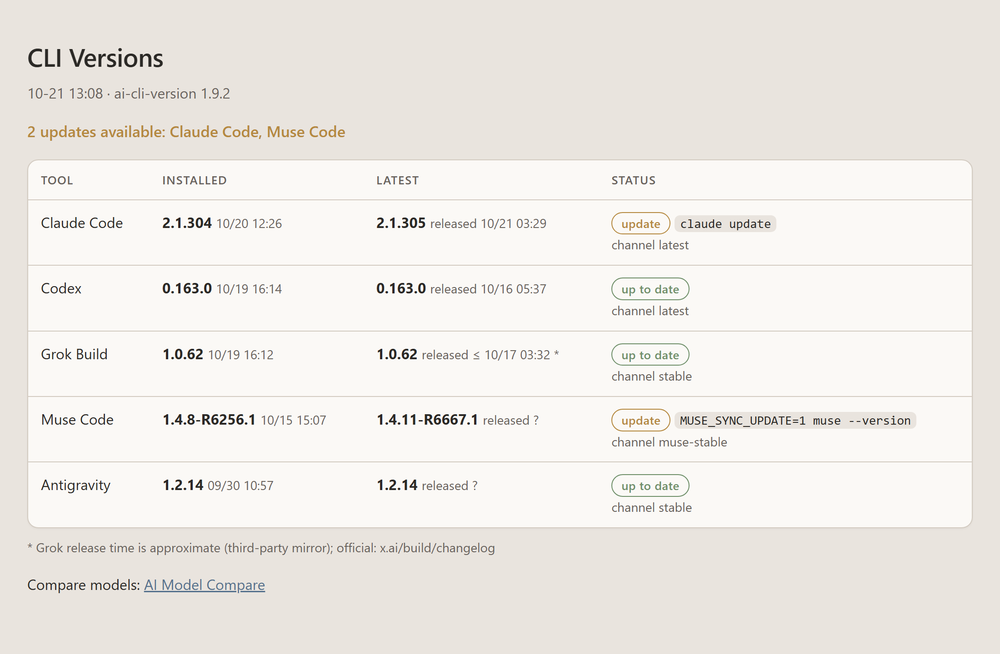

# ai-cli-version

One report for whether your Claude Code, Codex, Grok Build, Muse Code and Antigravity (Gemini) CLIs are up to date — the
version you have and when you installed it, the latest version and when it was released.

The version check is always read-only. When an update is available, the agent offers two
choices: `y` updates every outdated CLI, while `Esc` skips all updates.

Works in Claude Code, Codex CLI, Grok Build, and anything else that reads the `SKILL.md`
convention. Nothing here depends on a particular host.

> **Tested on Windows and macOS. Linux has not been tested yet.** The code has a Linux
> path and the install locations were checked against the vendors' install scripts, but
> it has never been run there. If it fails, please open an issue with the output of
> `./run.sh`.

[Traditional Chinese documentation](README.zh-TW.md)

## Before you install

### 1. Python 3.9 or newer

Standard library only, no `pip install`, no virtualenv.

```bash
python --version     # or: python3 --version   /   py --version  (Windows)
```

On Windows, avoid the `python3` alias: it is often a Microsoft Store stub that opens the
store instead of running anything.

On macOS, `/usr/bin/python3` (3.9) comes with the Xcode Command Line Tools; if they are
missing, the first run pops up an installer instead. Homebrew's `python3` also works. If
you installed Python from python.org, run its `Install Certificates.command` once —
without it every HTTPS request fails with `CERTIFICATE_VERIFY_FAILED` and each tool shows
`check failed`.

### 2. The CLIs you want checked

| Tool | CLI |
|---|---|
| Claude Code | `claude` |
| Codex | `codex` |
| Grok Build | `grok` |
| Muse Code | `muse` |
| Antigravity (Gemini) | `~/.gemini/bin/agy` |

**You do not need all five.** A tool that is not installed prints `not installed`; the
others still run. Signing in is not required to read versions.

### 3. Network and subprocess access

The skill launches the CLIs above and makes HTTPS requests to `registry.npmjs.org`,
`api.github.com`, `api.meta.ai` and the Antigravity CLI auto-updater on `run.app`, plus
one request to `raw.githubusercontent.com` for the skill's own update check.
**npm and Node.js are not required** — the registry is queried directly.

## Install

Global install, for all three CLIs at once:

```bash
npx skills add Jeinn-co/agent-skills@ai-cli-version -g -a claude-code codex grok -y
```

Drop `-a ...` to pick agents interactively, or name just the ones you use. `-g` installs
into your home directory, so every project sees it:

| Agent (`-a`) | Global skills folder |
|---|---|
| `claude-code` | `~/.claude/skills/` (or `$CLAUDE_CONFIG_DIR/skills/`) |
| `codex` | `~/.codex/skills/` (or `$CODEX_HOME/skills/`) |
| `grok` | `~/.grok/skills/` (or `$GROK_HOME/skills/`) |

Without `-g` it installs into the current project instead.

Or copy the `skills/ai-cli-version/` directory into those folders yourself. On Windows,
copy rather than symlink. On macOS or Linux, check that `run.sh` is still executable
after copying (`chmod +x run.sh`).

If `/ai-cli-version` is not visible immediately, start a new conversation or restart the
agent so it reloads its skill list.

## Update

```bash
npx skills update ai-cli-version -g -y    # global install
npx skills update ai-cli-version -p -y    # project install
```

A manually copied skill is not tracked; copy the directory again to update it.

## Usage

Type the skill name as a slash command:

    /ai-cli-version

Or just ask — "is my CLI up to date?", "check for updates", "when was this Codex released?". It reads
live every time; there is no cache or flag. If one or more versions are outdated, it
shows the report and waits for an explicit `y` before running their update commands.
Choose `Esc` to leave every CLI unchanged.

To run it outside an agent, change into the installed `ai-cli-version` directory — for
example `~/.claude/skills/ai-cli-version` — then use the launcher for your platform:

```bash
./run.sh          # macOS or Linux (or `sh run.sh` if it lost its executable bit)
py -3 run.py      # Windows; use `python run.py` if `py` is unavailable
```

Add `--version` to print the skill version and exit. Outside an agent you get the raw
tab-separated lines, not the formatted report.

All selected tools (every tool unless `setup` narrowed them) are checked **in parallel**, with a **20-second total budget per
tool** covering CLI startup and all network requests. A timed-out check and its
CLI children are stopped without retrying; other checks continue independently.
Rows stay in tool order. The check never runs an updater.

**Language.** Documentation and the scripts' data and status messages are in English.
Inside an agent, an explicit request for a report language takes priority. Otherwise,
the agent may use the computer's preferred language if its host provides that
information; when it is unavailable, the report and update prompt are in English.
A bare `/ai-cli-version` does not inherit the language of earlier conversation.
The script does not detect the OS display language or translate its raw output.
Tool names, versions, dates, commands and error codes stay unchanged, as do the
update choices `y` and `Esc`.

### Refresh in the browser

When the report is HTML, `/ai-cli-version` also starts a small local server in the
background (`run.py --serve`, Python standard library only) and opens
`http://127.0.0.1:47822/` instead of the file:

- **Refresh** re-checks every tool and swaps the new report in. While it runs, the old
  report is cleared and the page shows `Checking versions…`; a failed run shows the
  error, never the old versions. Reloading the page only re-reads the last report.
- **Update** appears on each row with an update, and **Update all (N)** at the top when
  there are two or more. While an updater runs, its row shows the elapsed seconds and
  the updater's own latest output line (no updater reports a percentage). Update all
  queues every tool with an update and runs them one at a time. While updates run, only
  cancelling works: a queued row's button reads `Queued · Cancel` and takes just that tool
  off the queue, and the top button reads `Cancel queued (N)` and drops every tool that
  has not started. The running row, the other rows and Refresh stay disabled until the
  queue ends, and the one already running always finishes, since stopping an installer
  halfway could leave a broken install. A failure does not stop the rest. When one finishes, the server
  re-checks just that tool and the page swaps in
  just its row (`Updated just now`, or the error and a **Retry** button); the rest of the
  report stays as it is. The page sends only the tool name: the server re-checks that
  tool first, does nothing if it is already current, and runs the same updater as its
  `update_cmd` without a shell (on Windows with `System32` first on PATH, so the Codex
  installer finds Windows' own `tar`). In the agent, updating still waits for `y` / `Esc`.
- `Updated MM-DD HH:MM:SS` is when the report on screen was written.
- **Auto / Light / Dark** picks the colours; Auto follows the OS, and the choice is kept
  in that browser.
- The server listens on 127.0.0.1 only, refuses other host names and framing by other
  sites, and starts a check or an update only for a request that carries its own header.

The server keeps running after the report, and later reports reuse it. To stop it, end
its Python process, the one running `run.py --serve --no-open`. Running `run.py --serve`
in a terminal starts it in the foreground (Ctrl+C stops it) only when none is running;
with one already running it says so and exits. If port 47822 is taken, or held by a
server from another copy of this skill, the report opens the file as before and says why
Refresh is unavailable. Tested on Windows 11; on Windows the server has no window. macOS
is not yet tested.

## What it prints

`/ai-cli-version` with demo data — all five CLIs checked, two updates available. By
default the report opens as an HTML page in your browser (Tailwind Slate palette, light
and dark mode), drawn by Python at no model-token cost. Shown here on the local page,
with its Update buttons, Update all, Refresh and theme switch:



Each row shows the version you have and when you installed it, the latest version and
when it was released, a status badge (`up to date`, or `update` with its command) and
the update channel. Grok Build's release time carries `≤` and the `*` footnote because it
comes from a third-party mirror; Muse Code's and Antigravity's are always `?` because
their update sources publish no date. The page ends with a link to
[AI Model Compare](https://jeinn-co.github.io/ai-model-compare/).

In chat the agent shows only the summary, a link to the page and, when something is
outdated, the update prompt:

> **→ 2 updates available:** Claude Code, Muse Code.
>
> **Report:** Open the HTML report
>
> **Update the 2 outdated CLIs now?** `[y]` Update all · `[Esc]` Skip

When every checked CLI is current, the summary reads **All up to date** and there is no
prompt. `setup` can switch the output to Markdown: the agent then renders the same table
in chat and opens no page.

The launcher prints these lines itself (`### SUMMARY`), so the agent only copies them
and loads a short `SKILL.md`.

### Skill updates

Before each run the agent first compares this skill with the `SKILL.md` published on
GitHub `main` (`run.py --check-skill`, one GET of `raw.githubusercontent.com`). When a
newer version exists, it asks `y` / `n` before doing anything else; `y` runs
`npx -y skills update -g ai-cli-version` and continues with the new version. When the
skill is current or the lookup fails, it goes straight to the check.

### Choose which CLIs to check

    /ai-cli-version setup

Setup first shows the current choice and asks **Keep** or **Change…**, so a saved
selection stays one click away. After **Change…**, a host with multi-select shows
checkboxes for installed CLIs, using multiple pages if needed. Other hosts show a
numbered list in the normal chat, one CLI and its current state per line, then ask
for numbers in a short input question (e.g. `1,2`). The list stays outside the question
widget so its layout remains readable. CLI names, `keep` and `all` also work;
cancellation keeps the saved selection unchanged. The output format — HTML or Markdown — is asked the same
way. Choices are saved in `~/.config/ai-cli-version/config.json`, so updating the skill
keeps them. Later checks skip the other tools and list them as
`Not checked (setup): …`. Choose every tool to go back to the default. Outside an agent:
`run.py --show-tools`, `run.py --set-tools claude,codex,grok`, `run.py --set-tools all`,
`run.py --set-output html|md`.

The prompt appears only inside an agent. The standalone `run.py` / `run.sh` launcher is
always check-only and continues to print raw report data without accepting input.

## Where each value comes from

| Tool | Installed version | Installed at | Latest version | Released |
|---|---|---|---|---|
| Claude Code | `claude --version` | `~/.local/share/claude/versions/<installed>` | npm registry, dist-tag = `autoUpdatesChannel` in `settings.json` (default `latest`) | npm publish time |
| Codex | `codex --version` | `$CODEX_HOME/packages/standalone/releases/<installed>-*` | npm registry, `@openai/codex` `latest` | npm publish time |
| Grok Build | `grok update --check --json` | `~/.grok/downloads/grok-<installed>-*` | same call | GitHub release of `timoteuszelle/x.ai-grok` (approximate) |
| Muse Code | `muse --version` | `muse-bin-<installed>*` next to the `muse` launcher | `https://api.meta.ai/muse-code/channels/<channel>` (public, the file the launcher reads) | not available (`?`) |
| Antigravity (Gemini) | `~/.gemini/bin/agy --version` | the `agy` binary | `Stable Version` on the CLI's own auto-updater (`antigravity-cli-auto-updater-….run.app`) | not available (`?`) |

`settings.json` is read from `$CLAUDE_CONFIG_DIR`, else `~/.claude`. `$CODEX_HOME`
defaults to `~/.codex`. If the installed-at path does not exist — npm or Homebrew
installs, or the macOS/Linux Grok installer, which saves builds as
`~/.grok/downloads/grok-<platform>` without a version — the real executable behind the
command is used instead.

Why not the CLIs' own updaters: `claude update` and `codex update` install immediately
and have no check-only option. `grok update --check` does, so Grok uses it. Muse has no
update subcommand at all: its launcher updates itself in the background whenever it
runs. The check sets `MUSE_NO_AUTO_UPDATE=1` so it stays read-only, and the offered
update command sets `MUSE_SYNC_UPDATE=1` to make the launcher update right away.

## Limitations and known issues

**Grok release time is approximate.** The official changelog, `x.ai/build/changelog`,
returns 403 to scripted requests, and `grok update --check --json` carries no date. The
time shown comes from a third-party NixOS package that publishes a GitHub release when it
detects a new Grok Build version, so the official release happened *no later than* that.
If the mirror stops publishing, the Grok release time shows `?`.

**Muse release time is not available.** The channel manifest carries a version and no
date, so the Muse release time always shows `?`. The channel is `$MUSE_CHANNEL`, else
the `.muse-channel` file next to the launcher, else `muse-stable`.

**Antigravity runs `~/.gemini/bin/agy`, never the `agy` on PATH.** The Antigravity IDE
installs an editor launcher with the same name, and running that opens a window. The
update command is therefore the full path, `~/.gemini/bin/agy update`. The auto-updater
lists versions without dates, so the release time always shows `?`; the note says how far
the current version has rolled out. The CLI also updates itself when it starts, so the
check runs `agy --version` with `AGY_CLI_DISABLE_AUTO_UPDATE=1` to stay read-only.

**Native builds are assumed to track npm.** The native installers of Claude Code and Codex
are not published through npm. This skill assumes they ship the same version numbers as
the npm packages. The version numbers matched when this was verified, but no vendor
document states it.

**Install time depends on the filesystem.** Windows and macOS record folder creation
time. Linux does not expose it through Python, so the folder's modified time is used,
which can be later than the install. Timestamps before 2015 are discarded.

**Installed-at paths are the vendors' current native layouts.** If a vendor moves them, the
skill falls back to the real executable, which can be less precise.

**Update commands were checked with native installs only.** The command shown is the
CLI's own updater. If you installed a CLI with Homebrew or npm, updating through that
package manager (`brew upgrade`, `npm install -g`) is the safe choice.

**Payload size.** The npm registry document for `@openai/codex` is about 14 MB, because it
lists every version; expect a second or two per run.

**Verified** 2026-09-17 on Windows 11 (zh-TW, Python 3.12) against `claude` 2.1.274,
`codex` 0.154.0 and `grok` 1.0.34. On the same date the Codex and Grok paths were checked
against their install scripts (`chatgpt.com/codex/install.sh`, `x.ai/cli/install.sh`).

**Verified** 2026-09-18 on macOS 26.6.2 (arm64, Python 3.10.8) against `claude` 2.1.273,
`codex` 0.154.0 and `grok` 1.0.34. The check-only launcher, version and timestamp lookup,
and global installation for Claude Code, Codex and Grok Build all completed successfully.
Linux has not been tested yet.

**Verified** 2026-09-24 on Windows 11 (zh-TW, Python 3.12) against Muse Code
1.3.0-R3401.1: version, install time, channel lookup, and the update command from both
bash and PowerShell. Muse on macOS and Linux has not been tested; the POSIX launcher
(`api.meta.ai/muse-launcher.sh`) uses the same file names and variables.

**Verified** 2026-10-02 on macOS (arm64, Python 3.10.8) against the Antigravity CLI
(`agy`) 1.2.14: version, install time and the updater's stable version. Windows and Linux
have not been tested for Antigravity.

## License

MIT
