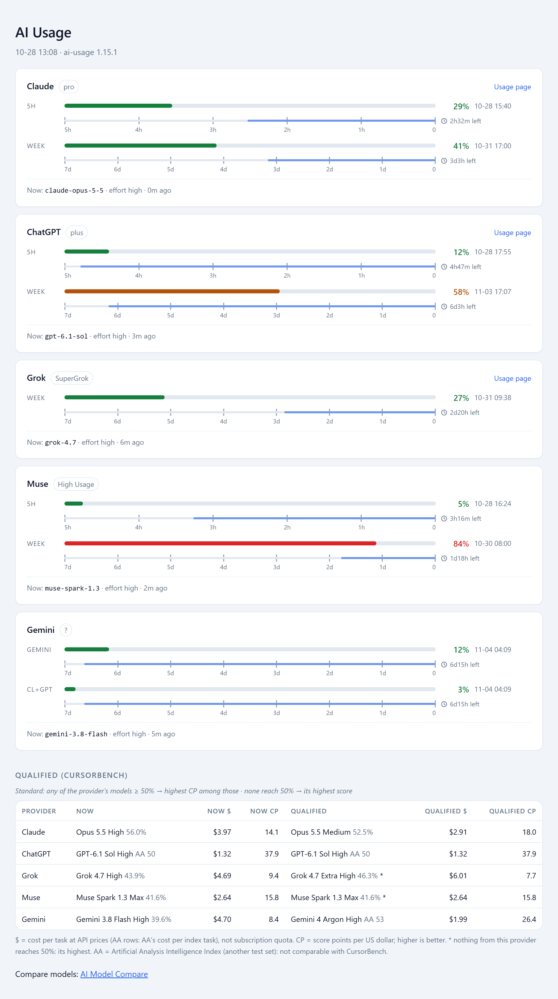

# ai-usage

One report for how much of your Claude, ChatGPT, Grok, Muse and Gemini (Antigravity CLI) subscription you have left —
percent used, when each window resets, and what top-up you have — plus which model
and effort each CLI is running now, and a shared model + effort pick per provider.

Works in Claude Code, Codex CLI, Grok Build, and anything else that reads the `SKILL.md`
convention. Nothing here depends on a particular host.

[Traditional Chinese documentation](README.zh-TW.md)

## Before you install

Read this first — the skill reports on tools it does **not** install for you.

### 1. Python 3.9 or newer

Standard library only, no `pip install`, no virtualenv.

```bash
python --version     # or: python3 --version   /   py --version  (Windows)
```

`run.py` launches each probe with the *same* interpreter you started it with
(`sys.executable`), so whichever of those names works for you is the right one. On
Windows, avoid the `python3` alias specifically: it is often a Microsoft Store stub
that opens the store instead of running anything.

### 2. At least one provider CLI, already signed in

| Provider | CLI | Sign in with |
|---|---|---|
| Claude | `claude` | `claude` once, then `/login` |
| ChatGPT | `codex` | `codex login` |
| Grok | `grok` | `grok` once, then follow the auth prompt |
| Muse | `muse` | `muse login` |
| Gemini | `~/.gemini/bin/agy` (Antigravity CLI) | run it once and follow the Google sign-in |

**You do not need all five.** Install one and you get one row; the others print
`not installed` and nothing else breaks. The skill never prompts for a login, never
opens a login browser automatically. Usage comes from authenticated CLIs or an
optional browser observation. For Claude quota and reset grants, the skill reads an
existing CLI access token from its environment, Keychain or credential file and sends
it only to the official api.anthropic.com HTTPS endpoint; without one it falls back to
`claude -p /usage`. It never refreshes, saves or prints tokens, and browser
observations do not read browser cookies.

### 3. Network and subprocess access

The agent host must allow this skill to launch local subprocesses. Each provider CLI
must also be able to reach its own service over the internet. Quota probes use
the provider CLIs or the optional browser adapter. Claude quota and reset grants
use one authenticated GET to api.anthropic.com with existing CLI credentials. The benchmark helper
also fetches public Artificial Analysis rows without credentials, and
the update check reads this skill's published `SKILL.md` from `raw.githubusercontent.com`, with skill archives downloaded from `codeload.github.com`.

### 4. Platform

macOS, Linux and Windows — but see [Limitations](#limitations-and-known-issues). The
launcher and `portable.py` handle Store-stub `python3`, npm `.cmd` shims that
`CreateProcess` refuses, and cp950/cp1252 stdout; verified 2026-09-14 on a zh-TW
Windows 11 machine.

### 5. Not required

No API key. No account beyond the subscriptions you already pay for. No Python package
installation: the skill uses only the standard library.

## Install

The `npx` method requires Node.js and npm. At the time of this release, `skills` CLI
1.5.26 declares Node.js 22.20 or newer:

```bash
node --version
npx --version
```

If that environment is not available, use the manual-copy method below; Node.js is not
needed when the skill runs.

```bash
npx skills add Jeinn-co/agent-skills@ai-usage     # just this skill
npx skills add Jeinn-co/agent-skills              # everything in the repo
```

Or copy a skill directory into your agent's skills folder — `~/.claude/skills/`,
`~/.codex/skills/`, `~/.grok/skills/`.

On Windows, copy the directory rather than linking it; if you do want a link, use a
junction (`mklink /J`), which needs no elevation. Never commit a symlink into this
repo — Git for Windows checks it out as a text file containing the target path and the
skill silently stops working.

If `/ai-usage` is not visible immediately after installation, start a new conversation
or restart the agent so it reloads its skill list.

## Update

Each invocation automatically updates the skill before continuing, including manual
copies. Installer-managed copies can also be refreshed explicitly:

```bash
npx skills update ai-usage -g -y    # global install
npx skills update ai-usage -p -y    # project install
```

Open a new conversation or restart the agent after updating so it reloads the skill.
The invocation-time Python updater also supports manually copied skills; installer records are not required.

## Usage

Type the skill name as a slash command:

    /ai-usage

That is the whole interface. It reads live every time, so there is no cache to clear
and no refresh flag to remember. To run it outside an agent, first change into the
installed `ai-usage` directory, then use the launcher for your platform:

```bash
./run.sh          # macOS or Linux
py -3 run.py      # Windows; use `python run.py` if `py` is unavailable
```

The report's title line ends with the skill version that produced it. Add `--version`
to the platform command to print the version alone and exit.

The five provider lookups and local session reads start **in parallel**. Benchmark
requests also overlap the usage lookups once model/effort is known. The report keeps
its provider order; waiting times are no longer added one provider at a time.
Each provider lookup has a **20-second total budget**, including CLI startup and
all requests in that probe. A timeout stops the probe and its CLI children and continues with the others
without retrying. Complete validated quota windows already received are retained;
optional details are marked unavailable. Claude reset work uses only the time left
after quota lookup, never a new 20-second budget. The
benchmark lookup has its own 20-second budget; if it times out, usage is still shown
and the benchmark table is omitted. A slow or unsubscribed CLI cannot hold up the
report for 90 seconds.

### Refresh in the browser

If Claude or ChatGPT CLI auth expires, click **Sign in to Claude** or
**Sign in to ChatGPT** on its card. This explicit click runs the CLI's official
subscription sign-in, which opens a browser on the
machine serving this localhost report. Complete authorization there; the report
refreshes only after the CLI confirms a valid login. No tokens or authorization URLs
pass through the report. Loading or refreshing the page never starts login.
The flow is single-instance and times out after 5 minutes. Headless/remote hosts or
static HTML exports should use the shown terminal fallback (`claude auth login` or
`codex login`). ChatGPT uses the [official Codex browser login](https://learn.chatgpt.com/docs/auth#sign-in-with-chatgpt).


When the report is HTML, `/ai-usage` also starts a small local server in the background
(`run.py --serve`, Python standard library only) and opens `http://127.0.0.1:47821/`
instead of the file:

- **Refresh** shows a skeleton for every card and the benchmark table, then fetches
  each provider with its own request: a card fills in as soon as its CLI answers, never
  waiting for the others. The page gives each lookup up to **90 seconds** instead of 20.
  A card that fails says so in place; old numbers are never shown as current.
  Reloading applies the current template to saved data and preserves its capture time; timed-out cards retain the automatic retry described below.
- A card whose lookup timed out in the chat report (20 s) is fetched again with the
  page's 90-second budget as soon as the page opens, behind a skeleton.
- `Updated MM-DD HH:MM:SS` is when the report on screen was written.
- **Auto / Light / Dark** picks the colours; Auto follows the OS, and the choice is kept
  in that browser.
- The server listens on 127.0.0.1 only, refuses other host names and framing by other
  sites, and starts a run only for a request that carries its own header.

The server keeps running after the report, and later reports reuse it. To stop it, end
its Python process, the one running `run.py --serve --no-open`. Running `run.py --serve`
in a terminal starts it in the foreground (Ctrl+C stops it) only when none is running;
with one already running it says so and exits. A server left by an older version of the
same copy (after a skill update) is stopped and replaced. If port 47821 is taken, or
held by a server from another copy of this skill, the report opens the file as before
and says why Refresh is unavailable. Tested
on Windows 11; on Windows the server has no window. macOS is not yet tested.

### Skill updates

Before each invocation the agent runs `run.py --update-skill`. A newer version on
GitHub `main` is downloaded and installed automatically, then the agent re-reads
`SKILL.md` and continues the original request. No y/n prompt is shown for the skill.
The shared Python updater replaces only this installed folder, including manual
copies; Node/npm and installer records are not needed. It validates the downloaded
bundle before replacement and restores the old copy if replacement fails. User
settings outside the skill folder are preserved. Development checkouts are not
replaced. An update failure reports its reason and local version; a usable local copy immediately
continues the original request without a prompt. Only a missing/unusable local copy stops it.
Use `run.py --check-skill` for a read-only check. Provider CLI updates and login
flows retain their existing confirmation requirements.

### Choose which providers to report

    /ai-usage setup

Setup first shows the current choice and asks **Keep** or **Change…**, so a saved
selection stays one click away. After **Change…**, a host with multi-select shows
checkboxes for installed CLIs, using multiple pages if needed. Other hosts show a
numbered list in the normal chat, one CLI and its current state per line, then ask
for numbers in a short input question (e.g. `1,2`). The list stays outside the question
widget so its layout remains readable. CLI names, `keep` and `all` also work;
cancellation keeps the saved selection unchanged. Choices are saved in `~/.config/ai-usage/config.json`, so updating the
skill keeps them. Later reports skip the other providers — no CLI is launched for them,
so a skipped Muse costs no probe call — and list them as `Not checked (setup): …`.
Choose every provider to go back to the default. Outside an agent:
`run.py --show-providers`, `run.py --set-providers claude,codex`,
`run.py --set-providers all`.

## What it prints

`/ai-usage` with demo data. By default the report opens as an HTML page in your browser
(Tailwind Slate palette, light and dark mode), drawn by Python at no model-token cost:



Read top to bottom:

1. **One card per provider**, stacked — Claude, ChatGPT, Grok, Muse and Gemini, with
   inline SVG product marks (LobeHub Icons, MIT); no image requests are needed. Each
   window has a colour bar that shifts from green (0%) through yellow (50%) to red (100%), the percent
   used and the reset clock. Grok has one weekly window; Gemini has two weekly pools
   (`gemini` for Gemini models, `cl+gpt` for the Claude and GPT models Antigravity also
   offers); the others have a 5-hour window and a week.
2. **Time-left bar** — under each usage bar, a thin bar whose full length is the window:
   5 hours or 7 days, with a tick and a number for every hour or day (`5h … 0`,
   `7d … 0`). The time left fills from the right and is labelled with a clock icon, such
   as `2h32m left`. When the usage bar is ahead of the time bar, you are using the window
   faster than it runs out.
3. **Now** — the model and effort of that CLI's newest local session, plus a link to the
   provider's own usage page (Claude, ChatGPT, Grok).
4. **My usage** — personal model and effort choices from `DAILY_CHOICES`, with a
   link to AI Model Compare for official guidance, effort and API prices, plus
   personal choices for the six delegated roles. These display preferences are
   separate from the actual s-agent defaults in Notion. Report generation does
   not change CLI settings or fetch/sync Notion.
   Security uses Opus 5.5 / max, GPT-6 Astra / max and Gemini 4 Carbon / high.
   Executor uses Gemini 4 Hydrogen / high (Notion snapshot, 2026-11-13).
   The current Antigravity table lists Hydrogen for Free, Plus, Pro, Ultra and Enterprise (rechecked 2026-11-13).
   Carbon requires Ultra or Enterprise; Argon supports Pro (†), Ultra or Enterprise; † includes paid Pro or trials with eligible premium devices.
   Paid Gemini API access is separate. The report does not verify account access.
5. **Score 50+ (Artificial Analysis)** — a third-party benchmark for reference, not official
   guidance. One row per CLI. *Now* is the model + effort you
   ran last; *Score 50+* is the model + effort the pick rule chooses among scores of 50 or more. Each side shows its AA
   Intelligence Index, `$` (AA's cost per index task at API prices) and CP (index ÷ `$`).
   `*` marks a provider with nothing at 50, so its highest score is shown.
6. **Model selection guide** — a link to [AI Model Compare](https://jeinn-co.github.io/ai-model-compare/).

In chat the agent shows only the recommendation — **→** which tool to use right now (the
one with the most usage left in its tightest window, free or unnamed plans such as Gemini's `?` skipped; AA score breaks a near tie) and why, after a **Warning** line when a weekly window is over 80% — and a link to the page.
The launcher works these lines out itself (`### ADVICE`), so the agent only copies them and
loads a short `SKILL.md`; running `./run.sh` in a terminal shows the same lines at no token cost.
The report is always the HTML page. Its **EN / 中文** button switches the page between
English and Traditional Chinese and remembers the choice for the next report; with no
choice yet, the page follows the browser's language.

It uses each provider's existing CLI login, so running it inside Codex also reads
your Claude, Grok, Muse and Gemini accounts.

**Usage numbers are live.** When a connected-browser tool is available, `/uu` reads Claude
Usage there and labels the source and check time. Browser observations expire after
5 minutes; rerun `/uu` to read the browser again (HTML Refresh cannot drive the connected browser).
Otherwise Claude uses its existing OAuth login to query Anthropic, and the other
usage windows come from the provider CLIs:

| Provider | How |
|---|---|
| Claude | OAuth GET `/api/oauth/usage`, using the CLI's existing login (environment, Keychain or file); `claude -p /usage` fallback |
| ChatGPT | `codex app-server` → JSON-RPC `account/rateLimits/read` |
| Grok | `grok agent stdio` → ACP extension method `_x.ai/billing` |
| Muse | `muse serve` → one tiny turn, then MSP `usage/read` |
| Gemini | `~/.gemini/bin/agy -p "/usage"` — the Antigravity CLI's built-in slash command |

**Muse costs one model call per run.** Muse keeps no usage on disk, and `session/start`
alone does not fetch it: the numbers arrive only with a model response. So the probe
sends `Reply with the single word: ok` at `minimal` effort, on the non-contributor twin
of the default model when the local catalog lists one. Each run spends a sliver of Muse
quota and leaves one session in Muse's history under
`<temp>/ai-usage-muse-probe`, which the `now` row skips.
If startup and the model response take more than 20 seconds, the launcher stops
the probe and reports a timeout instead of waiting longer.

**Gemini uses the Antigravity CLI at `~/.gemini/bin/agy`, never the `agy` on PATH.**
The Antigravity IDE installs an editor launcher with the same name, and running that
opens a window. `/usage` makes no model call, spends no quota and leaves no
conversation. The CLI reports what is left in each pool; the report shows it as used.
A signed-out agy opens the Google sign-in page in a browser, so the probe starts agy only
when the CLI's own log (`~/.gemini/antigravity-cli/log`) shows a signed-in run, and
otherwise reports the row as not signed in. No credential file is read. The probe also
sets `AGY_CLI_DISABLE_AUTO_UPDATE=1`, so agy does not update itself mid-report.

Providers whose CLI is not installed are reported as `not installed`; the rest still
run. What is deliberately left out is listed under
[Limitations](#limitations-and-known-issues).

**Current model and effort.** Under each provider, `now` shows the model and effort
of that CLI's newest local session, read from the session files the CLI already
writes (`session_info.py`; no network, nothing launched). It reflects the last turn
that was sent, so a model switched since then appears after the next message.

**Score 50+ (Artificial Analysis).** Below the providers, one table row per CLI you use:
the [Artificial Analysis](https://artificialanalysis.ai) Intelligence Index, cost per
index task, speed, verbosity and latency (the five figures on AA's model page) of the
exact model + effort that CLI ran last, plus CP (index ÷ cost per task, points per dollar
at API prices — higher is better). One score-50+ pick per provider: across every model and
eligible effort AA lists for that provider, the best CP at an index of 50 or more
(Claude picks never use Fable, whatever its score, while retaining
their current-model measurements); when nothing from
that provider reaches 50, its highest score. Models that are not publicly available
(`UNAVAILABLE` in `cursorbench.py`, currently empty) are never picked. A model
AA does not list shows `not listed`, never a neighbouring row. CursorBench is no longer
used: Cursor runs it and its own Composer is on it.
`cursorbench.py` (the file keeps its old name) does not scrape AA itself: it reads the
`data/aa.json` rows [AI Model Compare](https://jeinn-co.github.io/ai-model-compare/)
publishes, which that site refreshes from Artificial Analysis every six hours. Benchmark
figures can therefore be up to six hours old. With the one update-check request to
`raw.githubusercontent.com`, those are the public HTTP requests the skill's own code
makes, and they send no credentials. Separately, Claude reset grants use one
authenticated GET to api.anthropic.com; its access token is never sent to these
public benchmark or update sources.

**Language.** Documentation and the scripts' data and status messages are in English.
Inside an agent, an explicit request for a report language takes priority. Otherwise,
the agent may use the computer's preferred language if its host provides that
information; when it is unavailable, the report is in English. A bare `/ai-usage`
does not inherit the language of earlier conversation. The scripts do not detect the
OS display language or translate their raw output. Model IDs, numbers, dates, times,
commands and error codes are never translated.

See [`references/providers.md`](references/providers.md) for how each usage method
was found, including the dead ends, so nobody has to re-walk them.

## Limitations and known issues

**Platform.** Developed and verified on macOS. Linux is untested but uses the same
code path. **Windows was verified 2026-09-14** on a zh-TW Windows 11 machine
(PowerShell, Python 3.12) — the launcher and `portable.py` handle Store-stub
`python3`, `.cmd` shims that `CreateProcess` refuses, and cp950/cp1252 *our own*
stdout. That first real run also caught a bug this paragraph used to gloss over:
`subprocess`'s `text=True` decodes a *launched CLI's* output with the OS locale
encoding, not UTF-8, so Claude's usage line raised `UnicodeDecodeError` under cp950.
Fixed by pinning `encoding="utf-8"` in `portable.text_kwargs()` (used by all three
probes). Only tested on one Windows machine and one non-English locale so far — other
locales or Windows builds may still surface something new. Bug reports from Windows
are welcome and will be believed over this paragraph.

**Version-pinned.** Verified 2026-09-12 against `claude` 2.1.268, `codex` 0.154.0,
`grok` 1.0.25. Grok's omitted `creditUsagePercent` re-checked 2026-09-22 on
`grok` 1.0.40. The session and model-cache fields read by `session_info.py` were
verified 2026-09-22 against `claude` 2.1.278, Codex sessions written by the VS Code
extension (0.154.0-alpha), and `grok` 1.0.40. Muse (probe and session fields) verified
2026-09-24 against Muse Code 1.3.0-R3401.1 on Windows 11. Gemini (probe and session
fields) verified 2026-10-02 against the Antigravity CLI (`agy`) 1.2.14 on macOS.

Claude quota reading was rechecked on Windows 11 with Claude Code 2.1.319 on
2026-11-09. `claude -p --output-format json "/usage"` returned a cost summary instead
of quota windows. The probe now reads structured `five_hour` and `seven_day` data
from Anthropic using the existing OAuth login (credentials file, Keychain or environment),
also verified on macOS with Claude Code 2.1.318. `/usage` text stays as the fallback.

| Risk | Where | What happens if it breaks |
|---|---|---|
| Claude's OAuth usage endpoint and credential file are internal interfaces | `claude_usage.py` | Missing login, HTTP failures and invalid quota data fall back to `claude -p /usage`, which fails visibly if its text changed; the reset row names the failure |
| Codex's app-server protocol is private to OpenAI and carries no compatibility promise | `codex_usage.py` | A method rename or missing required field makes the ChatGPT row fail visibly; it never defaults to 0% |
| Grok's `_x.ai/billing` is a vendor ACP extension, not part of the ACP spec | `grok_usage.py` | A method rename or missing required field (period, `billingPeriodEnd`) makes the Grok row fail visibly. An omitted `creditUsagePercent` means a whole-percent 0 and prints `<1% used` |
| Muse's `usage/read` returns only what the host has observed | `muse_usage.py` | If the turn ends with no usage, the Muse row fails visibly (`no usage observed`); it never defaults to 0% |
| Gemini's `/usage` output is tab-separated text from the Antigravity CLI, which is undocumented | `agy_usage.py` | A changed layout makes the Gemini row fail visibly (`usage call failed`); it never defaults to 0% |
| Session files and model caches are internal to each CLI and undocumented | `session_info.py` | A renamed field prints `?` for that value; a moved file prints `no local session`. The usage rows are unaffected |
| Benchmark rows come from AI Model Compare's published JSON, and model ids are mapped to its names by rule | `cursorbench.py` | If the site is down the table prints `bench failed (...)` and the usage rows are unaffected. A model the rules cannot map, or a name the source spells differently, shows `not listed`; an AA effort without a cost is left out, never filled from another row |

**Banked resets (local extension).** ChatGPT reads `rateLimitResetCredits` from the
documented app-server response: count and per-reset expiry. Claude reads reset grants
from its read-only OAuth usage endpoint using existing CLI credentials, or uses
visible reset details from a fresh connected-browser observation. Dates use the host local timezone by default (a per-user
fixed offset is optional) and show time remaining; reset titles and timezone labels
are hidden. Missing fields stay unavailable, never zero. Paid top-ups are separate.
The reset lookup never refreshes or writes credentials, reads browser cookies, or
redeems resets. An unavailable reset lookup leaves valid usage windows intact.
The Claude grants endpoint is undocumented; changed fields remain unavailable.
HTML timers use original expiry epoch milliseconds, including seconds and DST folds.
Internal `reset-expiry` JSON records travel in saved raw reports and card responses,
but are hidden from normal terminal output. Old text-only reports
remain readable with static expiry text; no ambiguous local date is guessed.

**Deliberately not reported.** A wrong number here is worse than no number:

- **Claude extra usage** is not reported. The probe reads only the aggregate
  `five_hour` and `seven_day` windows; `fast_mode_disabled_reason` is specifically about fast mode.
- **Grok has one window, not two.** No 5-hour row is invented for it.
- **Gemini has two weekly pools and no 5-hour window**, and its plan name is not
  reported: `/usage` names no plan, so the plan shows `?`.
- **Grok `creditUsagePercent` omitted** means under 1%: the API sends whole percents
  and drops a 0. The probe prints `<1% used` with an empty bar.
- **Grok prepaid / on-demand at 0** is omitted. The values are readable; printing
  `prepaid 0 / on-demand 0` is noise. The line appears only when any value is
  non-zero.
- **Muse plan name** comes from a small table of known tier ids (`TIER_NAMES` in
  `muse_usage.py`; `27681527378179523` is `High Usage`, matched against Muse's plan
  page). `usage/read` gives only the numeric id, so any id not in that table shows `?`
  rather than a guessed name.

**Numbers are per-account, not per-machine.** Claude's `/usage` notes its breakdown is
approximate and covers local sessions on this machine only; the headline percentages
are account-wide.


## Report configuration

Edit `data/personal-choices.json` to change the Claude, Codex and Gemini choices
shown under My usage in both languages. For repository development, edit the
canonical `shared/personal-choices.json` and distribute it with `scripts/sync_shared.py`.
The HTML template contains no personal model or effort values.

`guidance_data.py` loads personal daily and role choices from that JSON. Model facts
come from `data/gemini-models.json`, distributed from the repository's shared
catalog. `cursorbench.py` derives supported Gemini efforts from that catalog.
Adding a model does not require editing the HTML template or s-agent's Python code.

UI translations live in `locales/en.json` and `locales/zh-TW.json`; common controls
are distributed into `locales/common/`. Both Python-rendered text and browser
controls use those catalogs. Pinned i18next 27.1.1 and its MIT license are bundled
under `assets/`, and the report embeds its JavaScript and translations for offline use.
The page template is `templates/report.html`; the browser controller, toolbar styles
and reset-expiry timer are `assets/report.js`, `assets/toolbar.css` and
`assets/reset-expiry.js`. Python files handle report data and server orchestration.

## License

MIT
