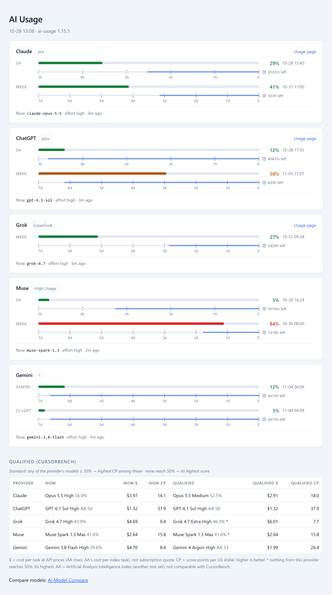

# ai-usage

> 中文版。英文版 [README.md](README.md) 為準，本檔為對照翻譯，兩邊同步更新。

一份報表看完 Claude、ChatGPT、Grok、Muse、Gemini（Antigravity CLI）五邊訂閱還剩多少 —— 用掉幾 %、各視窗何時重置、
還有多少加購額度；另外顯示每個 CLI 目前用的 model 與 effort，以及每家一組共用的
model + effort 推薦。

可在 Claude Code、Codex CLI、Grok Build，以及任何讀 `SKILL.md` 慣例的 agent 使用，
不綁定特定 host。

## 安裝前必讀

先看這段 —— 這個 skill 只會**回報**這些工具的用量，不會幫你安裝它們。

### 1. Python 3.9 以上

只用標準函式庫，不需要 `pip install`，不需要虛擬環境。

```bash
python --version     # 或: python3 --version   /   py --version  (Windows)
```

`run.py` 會用**啟動它的那個直譯器**（`sys.executable`）去跑三個 probe，所以上面哪個
名字在你機器上能動，哪個就是對的。Windows 上請特別避開 `python3` 這個別名：它常常是
Microsoft Store 的 stub，執行後會跳出商店頁面而不是跑程式。

### 2. 至少一個 provider CLI，而且已經登入

| Provider | CLI | 怎麼登入 |
|---|---|---|
| Claude | `claude` | 先跑 `claude`，再輸入 `/login` |
| ChatGPT | `codex` | `codex login` |
| Grok | `grok` | 先跑 `grok`，依提示完成認證 |
| Muse | `muse` | `muse login` |
| Gemini | `~/.gemini/bin/agy`（Antigravity CLI） | 執行一次，依提示完成 Google 登入 |

**五個不必裝滿。** 裝一個就有一列，其他印 `not installed`，不會因此壞掉。這個 skill
不會自動開啟登入頁。用量由 CLI 或可選瀏覽器觀測取得。Claude 額度與 reset 查詢會從環境變數、
Keychain 或 CLI 憑證檔讀取既有 access token，只送往官方 api.anthropic.com HTTPS 網域，
沒有登入時改用 `claude -p /usage`；不自行更新、不另存、不輸出 token，瀏覽器觀測也不讀 cookies。

### 3. 網路與 subprocess 權限

Agent host 必須允許這個 skill 啟動本機 subprocess。每個 provider CLI 也必須能連上自己的
網路服務。Claude 探針會向 `https://api.anthropic.com/api/oauth/usage` 發送帶認證的 GET。
其他 provider 在 CLI 內處理認證。benchmark 輔助程式另外讀取公開資料，不帶憑證；更新檢查會從
`raw.githubusercontent.com` 讀取這個 skill 已發佈的 `SKILL.md`。

### 4. 平台

macOS、Linux、Windows 都支援 —— 但請看[限制與已知問題](#限制與已知問題)。啟動程式與
`portable.py` 已處理 Store stub 的 `python3`、`CreateProcess` 不吃的 npm `.cmd` shim，
以及 cp950/cp1252 stdout；2026-09-14 已在一台繁中 Windows 11 機器上實測跑通。

### 5. 不需要什麼

不需要 API key。不需要你已付費訂閱以外的任何帳號。不需要安裝 Python package：skill
只使用標準函式庫。

## 安裝

用 `npx` 安裝需要 Node.js 與 npm。這個版本發布時，`skills` CLI 1.5.26 宣告需要
Node.js 22.20 以上：

```bash
node --version
npx --version
```

如果環境不符合，請改用下方的手動複製方式；skill 執行時不需要 Node.js。

```bash
npx skills add Jeinn-co/agent-skills@ai-usage     # 只裝這一個 skill
npx skills add Jeinn-co/agent-skills              # 裝整個 repo
```

或是直接把 skill 目錄複製到你的 agent skills 資料夾 —— `~/.claude/skills/`、
`~/.codex/skills/`、`~/.grok/skills/`。

Windows 上請用複製，不要用連結；真的要連結就用 junction（`mklink /J`），它不需要提升
權限。**絕對不要把 symlink commit 進這個 repo** —— Git for Windows 會把它 checkout 成
一個內容是路徑字串的純文字檔，skill 會無聲無息地失效。

如果安裝後沒有立刻看到 `/ai-usage`，請開新對話或重新啟動 agent，讓它重新載入 skill 清單。

## 更新

每次呼叫都會先自動更新 skill，再繼續原本工作，手動複製的副本也適用。
透過安裝器管理的副本，也可明確執行：

```bash
npx skills update ai-usage -g -y    # global 安裝
npx skills update ai-usage -p -y    # project 安裝
```

透過安裝器更新後請開新對話或重新啟動 agent，讓它重新載入 skill。
手動複製的副本使用相同的呼叫時自動更新流程，不需要安裝紀錄。

## 使用

把 skill 名稱當 slash command 打：

    /ai-usage

介面就只有這樣。它每次都讀即時資料，沒有快取要清，也沒有 refresh flag 要記。如果要
不透過 agent 直接執行，先切換到已安裝的 `ai-usage` 目錄，再使用對應平台的啟動方式：

```bash
./run.sh          # macOS 或 Linux
py -3 run.py      # Windows；如果沒有 `py`，改用 `python run.py`
```

報表標題列最後會顯示產生這份報表的 skill 版本。在對應平台指令後加 `--version`，就會只印出
skill 版本後結束。

五家供應商查詢與本機 session 讀取會**並行啟動**；取得 model／effort 後，
benchmark 也與用量查詢同時進行。報表仍維持固定順序，等待時間不再逐家累加。
每家供應商的查詢都有 **20 秒總上限**，包含 CLI 啟動及該探針的全部請求。
超時會停止探針與它啟動的 CLI 子程序，直接繼續其他供應商，不重試。
已收到且驗證完整的用量窗口會保留，選配細節改標 unavailable；Claude reset 查詢
只用取得用量後剩下的時間，不另加一份 20 秒預算。
Benchmark 查詢另有 20 秒上限；超時仍顯示用量，但省略 benchmark 表格。
沒有訂閱或回應較慢的 CLI 不會再讓報表等 90 秒。

### 在瀏覽器裡刷新

報表是 HTML 時，`/ai-usage` 會在背景啟動一個本機小服務（`run.py --serve`，只用 Python
標準函式庫），改開 `http://127.0.0.1:47821/`，不再開檔案：

- 按 **Refresh** 會先把每張卡片與 benchmark 表格換成 skeleton，再為每家供應商各發一個請求：
  哪家 CLI 先回應就先填上，彼此不等待。頁面上每次查詢最多等 **90 秒**，不是 20 秒。
  失敗的卡片會就地顯示錯誤，不會把舊數字當成最新。重新載入會以目前模板呈現已保存資料並保留擷取時間；逾時項目仍依下述規則自動重試。
- 對話報表裡超過 20 秒而逾時的卡片，在頁面開啟時會以 skeleton 顯示並用 90 秒上限重新抓取。
- `Updated MM-DD HH:MM:SS` 是畫面上這份報表寫入的時間。
- **Auto / Light / Dark** 切換配色；Auto 跟著系統，選擇會記在該瀏覽器。
- 服務只聽 127.0.0.1，拒絕其他主機名稱與其他網站嵌入，只有帶自訂 header 的請求才會重跑。

報表跑完後服務會繼續執行，之後的報表會沿用它。要停掉就結束它的 Python 程序，也就是
執行 `run.py --serve --no-open` 的那一個。在終端機執行 `run.py --serve` 只有在服務還沒在跑時
才會在前景啟動（按 Ctrl+C 停止）；已經有服務在跑時，它只會說明後就結束。同一份 skill
更新後留下的舊版服務會被停掉換新。port 47821 被佔用、或被另一份 skill 的服務佔住時，
報表照舊開檔案，並說明為什麼不能用 Refresh。
已在 Windows 11 測過，Windows 上服務不會開視窗；macOS 尚未測試。

### Skill 更新

每次呼叫時，agent 先執行 `run.py --update-skill`。GitHub `main` 有新版就自動下載
並安裝，再重新讀取 `SKILL.md`、繼續原本工作；skill 更新不再詢問 y/n。
共用 Python 更新器只替換目前的安裝目錄，手動複製的副本也適用，不需要 Node/npm
或安裝紀錄。下載內容先驗證完整性，替換失敗會還原舊副本；skill 目錄外的使用者
設定不會改動，開發用 checkout 不會被覆寫。失敗時回報原因，舊版仍可用就繼續。
只查不更新可執行 `run.py --check-skill`。Provider CLI 更新與登入仍依原本流程確認。

### 設定要報告哪些 provider

    /ai-usage setup

setup 先顯示目前設定，問**保留**或**修改**。選**修改**後，只列這台電腦已安裝的 CLI：
支援多選的 host 使用勾選清單，超出選項上限時分頁；其他 host 在一般對話中顯示**編號清單**，
每行一個 CLI 與目前狀態，再用簡短輸入框詢問要保留的編號（例如 `1,2`）。清單不塞進問題標題，
避免換行被擠成一段。也接受 CLI 名稱、`keep` 或 `all`；中途取消不會更改原設定。設定存在 `~/.config/ai-usage/config.json`，
更新 skill 也不會被蓋掉。之後的報告會跳過沒選的 provider —— 不會啟動它們的 CLI，所以跳過
Muse 時也不花那一次探測呼叫 —— 並列在 `Not checked (setup): …`。全部勾選就回到預設。
在 agent 外面：`run.py --show-providers`、`run.py --set-providers claude,codex`、
`run.py --set-providers all`。

## 輸出長什麼樣

`/ai-usage` 的示範資料。預設會在瀏覽器打開 HTML 報表（Tailwind Slate 配色、深淺色模式），由 Python
產生、不耗模型 token：



由上往下看：

1. **每家一張卡片，上下排列** —— Claude、ChatGPT、Grok、Muse、Gemini，附內嵌 SVG 產品圖示
   （LobeHub Icons，MIT），不需額外載入圖片。每個視窗有一條彩色
   進度條（依百分比漸變：0% 綠、50% 黃、100% 紅）、已用百分比與重置時間。Grok 只有一個週視窗；
   Gemini 有兩個週額度池（`gemini` 是 Gemini 模型，`cl+gpt` 是 Antigravity 另外提供的 Claude
   與 GPT 模型）；其他三家是 5 小時加一週。
2. **剩餘時間條** —— 每條用量條下面的細條，總長就是視窗長度：5 小時或 7 天，每小時或每天
   一個刻度並標上數字（`5h … 0`、`7d … 0`）。剩下的時間從右往左填，旁邊有時鐘圖示和文字，
   例如 `2h32m left`。用量條跑在時間條前面，就代表用得比時間過得快。
3. **Now** —— 該 CLI 最新一個本機 session 的 model 與 effort，以及這家自己的用量頁連結
   （Claude、ChatGPT、Grok）。
4. **我的用法** —— 從 `DAILY_CHOICES` 讀取個人的模型與 effort 選擇；官方說法、effort
   與 API 價格連到 AI Model Compare，並顯示六個派工角色的個人選擇。這些顯示偏好與
   Notion 的 s-agent 實際預設分開；產生報表不會修改 CLI 設定或讀取、同步 Notion。
   Security 使用 Opus 5.5 / max、GPT-6 Astra / max、Gemini 4 Carbon / high。
   Executor 使用 Gemini 4 Hydrogen / high（Notion 快照，2026-11-13）。
   2026-11-13 重新核對 Antigravity 官方表：Hydrogen 已列 Free、Plus、Pro、Ultra、Enterprise；Carbon 限 Ultra 或 Enterprise；Argon 為 Pro（†）、Ultra、Enterprise，† 指付費 Pro 或符合資格裝置的試用方案。
   API 使用資格另計，付費 Gemini API 也是另一個管道；報表不會驗證帳號使用資格。
5. **分數 50 以上（Artificial Analysis）** —— 第三方 benchmark，僅供參考，不是官方建議。每個 CLI 一列。「目前」是你最後用的 model + effort；
   「分數 50 以上」是挑選規則在 50 分以上的選項中選出的 model + effort。兩邊各有 AA 智力指數、`$`（AA 每題成本，依 API
   價格）與 CP（指數 ÷ `$`）。`*` 表示這家沒有任何一檔到 50，改列它的最高分。
6. **選型參考** —— 連到 [AI Model Compare](https://jeinn-co.github.io/ai-model-compare/)。

對話框裡只顯示推薦 —— **→** 現在該用哪一個（看最緊的視窗誰剩最多額度，免費或沒有方案名稱（如 Gemini 的 `?`）不算，差距 10 點內才比跑分）、附一句理由；週視窗超過 80% 時前面多一行
**Warning** —— 以及報表連結。這幾行由 launcher 自己算好（`### ADVICE`），agent 只照抄，載入的 `SKILL.md` 也很短；直接在終端機跑 `./run.sh` 一樣看得到，不耗 token。報表一律是 HTML 網頁；右上角的 **EN / 中文** 按鈕可切換英文與繁體中文，並記住選擇，下次開報表沿用；還沒選過時跟著瀏覽器語言。

它使用各 provider 現有的 CLI 登入資訊，在 Codex 裡面跑也能取得 Claude、Grok、Muse 和 Gemini 的數字。

**用量數字是即時的。** 有可用的瀏覽器整合工具時，Claude 可讀取已登入的 Usage 頁，標明來源與擷取時間；
快照 5 分鐘後失效。每次 `/uu` 會重讀瀏覽器，HTML Refresh 本身無法操作已連線瀏覽器。
沒有可用網頁資料時，Claude 用現有 OAuth 登入查詢 Anthropic，其他用量視窗直接問各家
自己的 CLI：

| Provider | 方法 |
|---|---|
| Claude | OAuth GET `/api/oauth/usage`，使用 CLI 現有登入（環境變數、Keychain 或憑證檔）；備援 `claude -p /usage` |
| ChatGPT | `codex app-server` → JSON-RPC `account/rateLimits/read` |
| Grok | `grok agent stdio` → ACP 擴充方法 `_x.ai/billing` |
| Muse | `muse serve` → 送一個極短的 turn，再呼叫 MSP `usage/read` |
| Gemini | `~/.gemini/bin/agy -p "/usage"` —— Antigravity CLI 內建的 slash command |

**Muse 每次會呼叫一次模型。** Muse 不把用量存在本機，只開 `session/start` 也拿不到；
數字只會跟著模型回應一起回來。所以探針用 `minimal` effort 送
`Reply with the single word: ok`，本機模型清單有非 contributor 版時就用那個。每次跑會用掉
一點點 Muse 額度，並在 Muse 歷史裡留下一個 session（位於
`<temp>/ai-usage-muse-probe`），`now` 那一列會跳過它。
啟動與模型回應若超過 20 秒，launcher 會停止探針並回報超時，不再繼續等待。

**Gemini 用的是 `~/.gemini/bin/agy` 這支 Antigravity CLI，絕不用 PATH 上的 `agy`。**
Antigravity IDE 會裝一個同名的編輯器啟動器，跑它會打開視窗。`/usage` 不呼叫模型、
不花額度，也不留下對話。CLI 回報的是每個額度池「還剩多少」，報表換算成「已用」。
沒登入的 agy 會自動打開瀏覽器到 Google 登入頁，所以探針只在 CLI 自己的 log
（`~/.gemini/antigravity-cli/log`）顯示登入過時才啟動 agy，否則那列回報「沒登入」。
不讀任何憑證檔。探針也會設 `AGY_CLI_DISABLE_AUTO_UPDATE=1`，agy 不會在跑報表時自我更新。

CLI 沒安裝的 provider 會回報 `not installed`，其他照跑。刻意不回報的項目列在
[限制與已知問題](#限制與已知問題)。

**目前的 model 與 effort。** 每家下面的 `now` 列，是該 CLI 最新一個本機 session 的
model 與 effort，讀的是 CLI 自己寫下的 session 檔（`session_info.py`；不連網、不啟動
任何程式）。反映的是最後送出的那一輪，所以之後才切換的 model 要等下一則訊息才會出現。

**分數 50 以上（Artificial Analysis）。** 各 provider 下方有一張表，每個你在用的 CLI 一列：該 CLI
最後一次用的 model + effort 在 [Artificial Analysis](https://artificialanalysis.ai) 的智力指數、
每題成本、speed、verbosity、latency（AA 模型頁那五個量值），以及 CP（指數 ÷ 每題成本，依 API
價格每 1 美元換到的分數，越高越划算）。每家再列一個「分數 50 以上」組合：在該家 AA 上所有模型與強度中，
指數 ≥ 50 且符合選用規則者裡 CP 最高的一檔（Claude 的挑選一律不選 Fable，不管分數多少，
但保留其目前模型實測數據）；整家都達不到 50 時，取該家最高分。尚未公開提供的模型（`cursorbench.py`
的 `UNAVAILABLE`，目前沒有）不會被選。AA 沒收錄的 model 顯示 `not listed`，絕不借用
相鄰那列的數字。不再使用 CursorBench：它由 Cursor 自己測，自家的 Composer 也在榜上。
`cursorbench.py`（檔名沿用）自己不爬 AA，而是讀 [AI Model Compare](https://jeinn-co.github.io/ai-model-compare/)
發布的 `data/aa.json`；那個網站每 6 小時從 Artificial Analysis 更新一次，所以跑分數字最多晚 6 小時。加上更新檢查對 `raw.githubusercontent.com` 的一次請求，
這些公開請求不帶憑證。Claude reset grants 另使用既有 CLI access token，
唯讀 GET 官方 api.anthropic.com；token 不會送給公開跑分或更新來源。

**語言。** 公開說明以英文為準，腳本的資料與狀態訊息使用英文。在 agent 裡，使用者明確指定
報表語言時優先採用該語言；否則可依 host 提供的電腦偏好語言輸出，沒有資訊時用英文。
單獨輸入 `/ai-usage` 不沿用先前對話語言。腳本本身不偵測作業系統顯示語言，也不翻譯原始輸出。
Model ID、數字、日期、時間、指令及錯誤代碼不翻譯。

每個用量方法是怎麼找到的（包含走過的死路，讓後人不用再走一次），見
[`references/providers.md`](references/providers.md)。

## 限制與已知問題

**平台。** 在 macOS 上開發並驗證過。Linux 未經測試，但走的是同一條 code path。
**Windows 已於 2026-09-14 驗證** —— 在一台繁中 Windows 11 機器（PowerShell、
Python 3.12）上實測跑通。啟動程式與 `portable.py` 處理了 Store stub 的
`python3`、`CreateProcess` 不吃的 `.cmd` shim，以及*自己*輸出用的 cp950/cp1252
stdout。這次實測也抓到一個這段文字之前沒提到的 bug：`subprocess` 的
`text=True` 是用作業系統 locale 編碼去解碼**被啟動的 CLI**的輸出，不是 UTF-8，
導致 Claude 的用量那行在 cp950 下丟出 `UnicodeDecodeError`。已透過
`portable.text_kwargs()` 固定 `encoding="utf-8"` 修好（三個 probe 都套用）。
目前只在一台機器、一種非英文 locale 測過，其他 locale 或 Windows 版本仍可能
踩到新問題。歡迎回報 Windows 上的 bug，回報內容的可信度高於這段文字。

**版本綁定。** 2026-09-12 針對 `claude` 2.1.268、`codex` 0.154.0、`grok` 1.0.25 驗證。
Grok 省略 `creditUsagePercent` 已於 2026-09-22 在 `grok` 1.0.40 上再確認。
`session_info.py` 讀的 session 與 model 快取欄位，於 2026-09-22 針對 `claude` 2.1.278、
VS Code 擴充寫出的 Codex session（0.154.0-alpha）、`grok` 1.0.40 驗證。Muse（探針與
session 欄位）於 2026-09-24 在 Windows 11 上針對 Muse Code 1.3.0-R3401.1 驗證。Gemini（探針與
session 欄位）於 2026-10-02 在 macOS 上針對 Antigravity CLI（`agy`）1.2.14 驗證。

2026-11-09 在 Windows 11、Claude Code 2.1.319 上重新確認，
`claude -p --output-format json "/usage"` 回傳成本摘要，缺少額度視窗。
探針改用既有 OAuth 登入（憑證檔、Keychain 或環境變數），向 Anthropic 讀取結構化的 `five_hour` 與 `seven_day`，
同日也在 macOS、2.1.318 驗證；`/usage` 文字保留為備援。

| 風險 | 位置 | 壞掉時會怎樣 |
|---|---|---|
| Claude OAuth 用量端點與憑證檔是內部介面 | `claude_usage.py` | 登入缺失、HTTP 失敗或額度資料無效時改用 `claude -p /usage`，其文字改版時明確失敗；reset 列標明失敗原因 |
| Codex 的 app-server 協定是 OpenAI 私有的，沒有任何相容性承諾 | `codex_usage.py` | 方法改名或必要欄位缺失時，ChatGPT 那列會明確失敗；絕不預設成 0% |
| Grok 的 `_x.ai/billing` 是廠商自訂的 ACP 擴充，不屬於 ACP 規格 | `grok_usage.py` | 方法改名或必要欄位（period、`billingPeriodEnd`）缺失時，Grok 那列會明確失敗。省略 `creditUsagePercent` 代表整數 0，印 `<1% used` |
| Muse 的 `usage/read` 只回報 host 觀察到的資料 | `muse_usage.py` | turn 結束仍沒有用量時，Muse 那列會明確失敗（`no usage observed`）；絕不預設成 0% |
| Gemini 的 `/usage` 輸出是 Antigravity CLI 的 tab 分隔文字，沒有公開文件 | `agy_usage.py` | 格式改變時 Gemini 那列會明確失敗（`usage call failed`）；絕不預設成 0% |
| session 檔與 model 快取是各 CLI 內部格式，沒有公開文件 | `session_info.py` | 欄位改名時該值印 `?`；檔案搬家時印 `no local session`。用量那幾列不受影響 |
| 跑分資料來自 AI Model Compare 發布的 JSON；model id 對應到它的名稱是靠規則 | `cursorbench.py` | 網站掛掉時印 `bench failed (...)`，用量那幾列不受影響。規則對不上、或名稱拼法不同時顯示 `not listed`；AA 沒有成本的強度直接略過，不會借用別列的數字 |

**Reset 券（本機擴充）。** ChatGPT 使用 app-server 的 `rateLimitResetCredits`：
數量與到期日。Claude 使用既有 CLI OAuth 憑證唯讀查詢 reset grants，或讀取新鮮的
已登入瀏覽器觀察；查詢本身不更新、不寫入憑證，也不讀取瀏覽器 cookies。
Claude grants API 未公開，欄位改變時顯示 unavailable，不影響已讀取的用量。
日期預設使用系統時區，可在個人設定指定固定時差；顯示剩餘時間，隱藏券名稱與時區標籤。
缺資料顯示 unavailable，不當成 0；付費 credits 餘額另計，不兌換 reset。
HTML 倒數直接使用原始 expiry epoch 毫秒，保留秒數與夏令時間重複時段。
內部 `reset-expiry` JSON 資料會保存在 raw report 與卡片回應，不會顯示在一般終端。
舊版純文字報表仍可顯示到期日期，但不反推可能有歧義的時間，因此只靜態顯示。

**刻意不回報的。** 這裡報錯數字比不報更糟：

- **Claude 的 extra usage** 不回報。探針只讀整體 `five_hour` 與 `seven_day` 視窗；
  `fast_mode_disabled_reason` 明確描述的是 fast mode。
- **Grok 只有一個視窗，不是兩個。** 不會幫它捏造一個 5 小時的列。
- **Gemini 只有兩個週額度池，沒有 5 小時視窗**，也不回報方案名稱：`/usage` 不提供方案，
  所以方案顯示 `?`。
- **Grok 省略 `creditUsagePercent`** 代表不到 1%：API 只回整數百分比，0 會被省略。探針印 `<1% used` 加空 bar。
- **Grok prepaid / on-demand 全為 0** 時省略。數字讀得到，但印 `prepaid 0 /
  on-demand 0` 是噪音。任一值非 0 才顯示那一行。
- **Muse 方案名稱**來自一張已知 tier id 的對照表（`muse_usage.py` 的 `TIER_NAMES`；
  `27681527378179523` 是 `High Usage`，已對照 Muse 的方案頁）。`usage/read` 只給數字
  id，不在表裡的 id 一律顯示 `?`，不猜名稱。

**數字是帳號層級，不是機器層級。** Claude 的 `/usage` 註明它的細項是近似值、且只涵蓋
本機的 session；但最上層那幾個百分比是整個帳號的。


## Claude / ChatGPT 登入按鈕

CLI 登入失效時，本機伺服器的報表會顯示 **Sign in to Claude** 或
**Sign in to ChatGPT**。只有使用者點擊才會執行官方 `claude auth login --claudeai`
或 `codex login`，在伺服器所在電腦開啟瀏覽器授權。
完成後先確認 CLI 已登入，再自動更新用量；報表不接收或儲存 token／授權網址。
不會因載入或 Refresh 自動啟動登入。同時僅允許一個流程，5 分鐘逾時可重試。
沒有桌面瀏覽器的遠端主機及靜態 HTML 匯出，使用畫面上的 CLI 指令登入。

## 報表設定

修改 `data/personal-choices.json` 即可同步變更中英文「我的用法」裡的 Claude、
Codex 與 Gemini 常用選擇。開發專案時修改原始的 `shared/personal-choices.json`，
再以 `scripts/sync_shared.py` 分發。HTML 模板不再存放個人的模型或 effort 值。

`guidance_data.py` 從該 JSON 讀取個人常用與角色選擇。模型資料從 `data/gemini-models.json`
讀取，此檔案由專案的共用目錄分發；`cursorbench.py` 從同一份模型目錄取得 Gemini
允許的 effort。新增模型不需修改 HTML 模板或 s-agent 的 Python 程式。

介面翻譯放在 `locales/en.json`、`locales/zh-TW.json`，共用控制項分發到
`locales/common/`。Python 產生的文字與瀏覽器控制項使用相同字典。i18next 27.1.1
與 MIT 授權檔放在 `assets/`，產出的 HTML 會內嵌程式與翻譯，可離線使用。
畫面模板是 `templates/report.html`；瀏覽器控制程式、工具列樣式與重置倒數分別是
`assets/report.js`、`assets/toolbar.css`、`assets/reset-expiry.js`。
Python 檔案負責報表資料與伺服器流程。

## 授權

MIT
